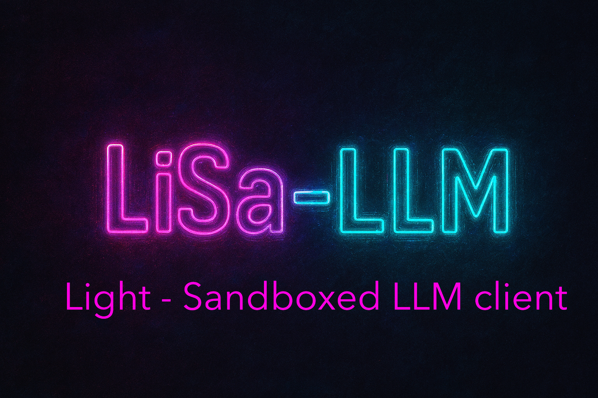
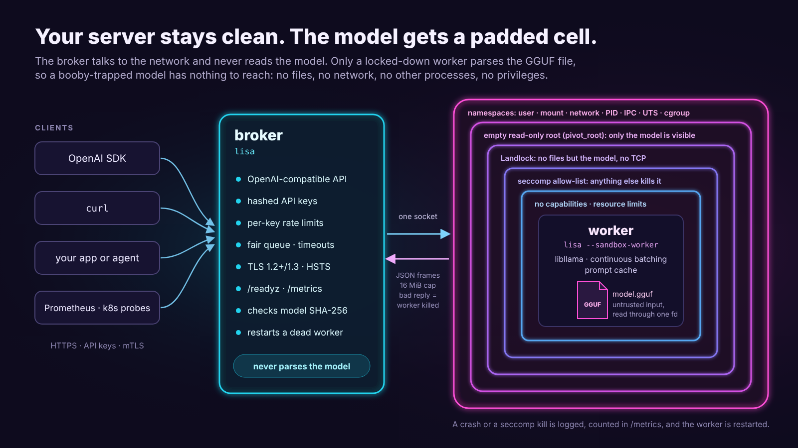
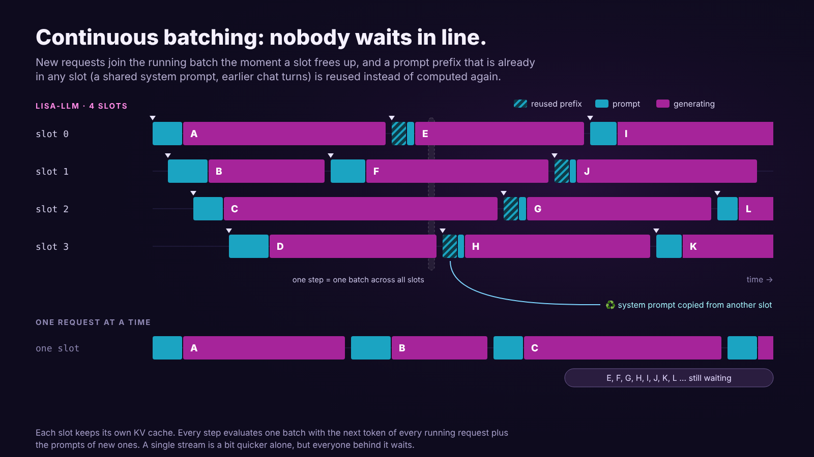
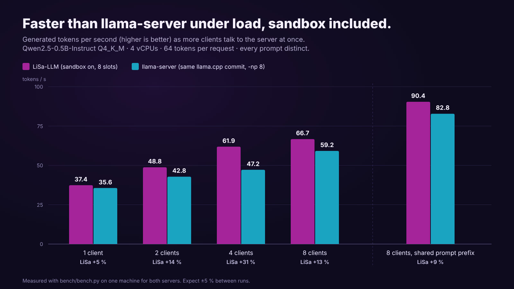

<div align="center">
  

  <h1>🛡️ LiSa-LLM</h1>

  <p><em>“Because your cat‑sized model deserves a lion‑sized sandbox.”</em></p>

  <p><strong>Your own private, OpenAI-compatible model server: fast, tiny, and paranoid in all the right ways.</strong><br>
  Drop in a GGUF file → get a ChatGPT-style API → sleep well, because the model runs in a padded cell.</p>

  <a href="https://github.com/Yog-Sotho/LiSa-LLM/actions/workflows/ci.yml"></a>
  <a href="https://github.com/Yog-Sotho/LiSa-LLM/actions/workflows/fuzz.yml"></a>
  <a href="https://github.com/Yog-Sotho/LiSa-LLM/releases"></a>
  
  
  
  
  
  
  <a href="https://github.com/Yog-Sotho/LiSa-LLM/stargazers"></a>
  <a href="https://github.com/sponsors/Yog-Sotho" target="_blank" rel="noopener"></a>
</div>

---

## 🤔 What is this?

You found a cool model on Hugging Face. You want your apps, scripts and agents to talk to it the
way they talk to ChatGPT. And you'd rather not hand a multi-gigabyte binary blob from a stranger
the keys to your server.

**LiSa-LLM** (**Li**ghtweight **Sa**ndboxed LLM server) does exactly that. One small binary, one
model file, and you get the **OpenAI API** (`/v1/chat/completions`, streaming and all) on your own
hardware. Every OpenAI SDK and most AI tools work with it unchanged: point them at your server
and go.

The twist: LiSa **never trusts the model file**. GGUF files are parsed by complicated code, and a
booby-trapped one could exploit it. So the part of LiSa that talks to the network never even opens
the model. A separate worker process does, after locking itself into a padded cell: no files, no
network, no other processes, no privileges, and a system-call filter that kills it the moment it
tries anything funny.

And it's **quick**: continuous batching and a prompt cache make it faster than llama.cpp's own
`llama-server` when several clients talk to it at once, sandbox included.

**What people build with it:**

- 🏠 A private ChatGPT for the family or the team, with no data leaving the house
- 🤖 A backend for agents, IDE plugins and chat UIs that speak "OpenAI"
- 🧪 A safe place to try random models from the internet
- 🏭 A production endpoint behind a load balancer, with keys, rate limits, TLS and Grafana dashboards
- 🧠 The teacher model for [Brainbrew](https://github.com/Yog-Sotho/Brainbrew), or the server for
  the models you fine-tuned with [LLM Fine-Tuner](https://github.com/Yog-Sotho/LLM-fine-tuner)

---

## ✨ Why LiSa slaps

- **🔒 Sandboxed by default.** The model runs in a worker with its own namespaces, an empty
  read-only root, no capabilities, Landlock and a seccomp allow-list. Crashes are logged and the
  worker restarts. The model never touches the process that faces the network.
- **🔌 OpenAI-compatible.** Chat and text completions, streaming, JSON mode, `usage` with cached
  tokens, OpenAI-style errors. Chat templates come straight from the GGUF file (54 built-in formats).
- **🚀 Continuous batching.** Up to `parallel_slots` requests generate together, and new prompts
  join the running batch instead of waiting their turn.
- **♻️ Prompt cache.** A shared system prompt or the earlier turns of a chat are reused, even
  across slots, instead of being computed again.
- **🧠 Any GGUF model.** Llama, Mistral, Qwen, Gemma, Phi, DeepSeek and friends, every
  quantisation, on llama.cpp's battle-tested engine.
- **🌐 Ready for the real world.** Hashed API keys, per-key rate limits, a fair bounded queue
  (429 + `Retry-After`), timeouts, TLS 1.3, mutual TLS, HSTS.
- **📈 Operable.** `/healthz`, `/readyz`, Prometheus `/metrics` (latency, queue wait, time to first
  token, tokens/s, worker restarts), JSON logs with request ids, graceful drain on SIGTERM.
- **📦 Zero-fuss installs.** One static binary for Linux x86_64 and arm64, or multi-arch container
  images, CUDA included.
- **🔏 Verifiable.** Every release is signed with Sigstore and ships SLSA provenance and SBOMs, so
  you can prove the binary came from this repo's source.
- **🧪 Tested like it matters.** 114 tests under AddressSanitizer, UBSan and ThreadSanitizer,
  real-model end-to-end tests, sandbox escape attempts, a deliberately hostile worker, libFuzzer,
  clang-tidy, cppcheck, CodeQL and an 85 % coverage gate, on every pull request.

---

## 🖼️ Gallery

<div align="center">

### 🔒 The padded cell



*The broker talks to the world and never reads the model. The worker reads the model and can't
talk to the world. A malicious GGUF gets a padded cell, not your server.*

---

### 🚀 Nobody waits in line



*New requests join the running batch the moment a slot frees up, and a prompt prefix that's already
cached is copied instead of computed again.*

---

### ⚡ Faster than llama-server under load



*Same machine, same model, same llama.cpp commit. LiSa runs with the sandbox on and still comes out
ahead, by up to 31 %.*

</div>

---

## 🚀 Get started in 2 minutes

### 1. Get LiSa

**Linux binary** (x86_64 or aarch64, any distro with glibc 2.35+):

```bash
VERSION=1.0.1 ARCH=x86_64        # or aarch64
curl -LO https://github.com/Yog-Sotho/LiSa-LLM/releases/download/v$VERSION/lisa-$VERSION-linux-$ARCH.tar.gz
tar xzf lisa-$VERSION-linux-$ARCH.tar.gz
sudo install -m 755 lisa-$VERSION-linux-$ARCH/bin/lisa /usr/local/bin/
```

### 2. Get a model

```bash
mkdir -p models
curl -L -o models/model.gguf \
  https://huggingface.co/Qwen/Qwen2.5-0.5B-Instruct-GGUF/resolve/main/qwen2.5-0.5b-instruct-q4_k_m.gguf
```

### 3. Start it

```bash
export LISA_API_KEYS="$(openssl rand -hex 24)"; echo "Your API key: $LISA_API_KEYS"
lisa --model models/model.gguf
```

Look for `"Sandboxed worker ready"` in the log: the model is loaded, inside the cell. 🎉

### Or with Docker

```bash
KEY="$(openssl rand -hex 24)"; echo "Your API key: $KEY"
docker run --rm -p 8080:8080 -v ./models:/models:ro \
  -e LISA_API_KEYS="$KEY" -e LISA_API_KEY= \
  ghcr.io/yog-sotho/lisa-llm:1.0.1           # :1.0.1-cuda for NVIDIA GPUs
```

[`docker-compose.yml`](docker-compose.yml) has ready-made CPU, sandboxed and GPU services. Building
from source, the sandbox in containers and the support matrix: [Installation](docs/installation.md).

### 🔏 Verify before you trust

Release archives and images are signed (Sigstore, keyless) and carry SLSA provenance and SBOMs.
Checking takes one command each, e.g.
`gh attestation verify lisa-1.0.1-linux-x86_64.tar.gz --repo Yog-Sotho/LiSa-LLM`.
All the commands: [Verifying a release](docs/installation.md#verifying-a-release).

---

## 💬 Talk to it

Anything that speaks OpenAI speaks LiSa:

```python
from openai import OpenAI

client = OpenAI(base_url="http://localhost:8080/v1", api_key="<your key>")
stream = client.chat.completions.create(
    model="model",                         # any name: one model is loaded
    messages=[{"role": "user", "content": "Write a haiku about sandboxes."}],
    stream=True,
)
for chunk in stream:
    if chunk.choices and chunk.choices[0].delta.content:
        print(chunk.choices[0].delta.content, end="")
```

```bash
curl http://localhost:8080/v1/chat/completions \
  -H "Authorization: Bearer $LISA_API_KEYS" -H "Content-Type: application/json" \
  -d '{"messages": [{"role": "user", "content": "Hello!"}], "max_tokens": 50}'
```

| Area | Supported |
|---|---|
| **Routes** | `/v1/chat/completions`, `/v1/completions`, `/v1/models`, plus `/healthz`, `/readyz`, `/metrics` |
| **Sampling** | `temperature`, `top_p`, `top_k`, `min_p`, presence/frequency/repeat penalties, `seed`, `stop` |
| **Output** | streaming (SSE) with optional usage, JSON mode (`response_format: json_object`, grammar-constrained) |
| **Not (yet)** | tools, `json_schema`, logprobs, `n` > 1, images: refused with a clear `400`, never silently ignored |

Everything else, with examples: [Using the API](docs/api.md).

---

## ⚡ Performance

Qwen2.5-0.5B-Instruct Q4_K_M on 4 vCPUs, 64 tokens per request, every prompt distinct. LiSa with
the **sandbox on** and 8 slots versus `llama-server -np 8` built from the same llama.cpp commit:

| Concurrent clients | LiSa-LLM | llama-server |
|---:|---:|---:|
| 1 | 37.4 tok/s | 35.6 tok/s |
| 2 | 48.8 tok/s | 42.8 tok/s |
| 4 | **61.9 tok/s** | 47.2 tok/s |
| 8 | **66.7 tok/s** | 59.2 tok/s |
| 8, shared prompt prefix | **90.4 tok/s** | 82.8 tok/s |

Measure your own box with `python3 bench/bench.py --url http://127.0.0.1:8080 --key "$KEY"`.
Methodology, time-to-first-token numbers, how batching works and how to tune it:
[Performance](docs/performance.md).

---

## 🔒 Security in one breath

The network-facing **broker** checks keys, rate-limits, queues and validates every request, and
**never parses the model**. The **worker** parses it inside user, mount, network, PID, IPC, UTS and
cgroup namespaces, on an empty read-only root, with no capabilities, Landlock and a seccomp
allow-list. The broker treats the worker as hostile too: a malformed reply gets it killed and
restarted. If the sandbox can't be set up, LiSa refuses to start rather than run unprotected.

Put it on a network the right way: [Security and the sandbox](docs/security.md) has the checklist,
and the [threat model](docs/project/threat_model.md) has every rule and its limits. Found a hole?
Please report it privately: [SECURITY.md](SECURITY.md).

---

## ⚙️ Configuration

One YAML file ([`config.yaml`](config.yaml), every option commented), `LISA_<KEY>` environment
variables for each setting, and a few flags (`--model`, `--host`, `--port`, `--check-config`,
`--health-check`, `--hash-key`). The ones you'll touch first:

| Setting | Default | What it does |
|---|---|---|
| `model_path` | | The GGUF file to serve |
| `listen_addr` / `listen_port` | `127.0.0.1` / `8080` | Where to listen |
| `api_keys` | | Keys or `sha256:` digests (`lisa --hash-key`) |
| `parallel_slots` | `4` | Requests generated together |
| `max_context` | `2048` | Context window per slot |
| `rate_limit_per_minute` | `0` (off) | Per-key rate limit |
| `enable_tls` | `false` | HTTPS (plus `client_ca_file` for mutual TLS) |
| `sandbox_enabled` | `true` | Run the model in the padded cell |

All of them: [Configuration](docs/configuration.md). Deploying with Docker, Kubernetes, systemd,
TLS or Prometheus: [Deployment](docs/deployment.md).

---

## 🗺️ What's built, what's coming

**Already available (v1.0.1):**

- ✅ llama.cpp engine: any GGUF model, every quantisation, optional CUDA offload
- ✅ OpenAI-compatible chat and completions, streaming, JSON mode, 54 chat templates
- ✅ Sandboxed model parsing, on by default, with crash recovery and model checksum pinning
- ✅ Continuous batching and a cross-slot prompt cache
- ✅ Hashed API keys, rate limits, fair queue, timeouts, TLS 1.3, mutual TLS
- ✅ Health and readiness probes, Prometheus metrics, JSON access logs, graceful drain
- ✅ Static Linux binaries (x86_64, arm64), multi-arch and CUDA container images
- ✅ Signed releases with SLSA provenance and SBOMs

**On the wishlist:**

- ⏳ `json_schema` structured output and tool calling
- ⏳ Jinja chat templates beyond llama.cpp's 54 built-in formats
- ⏳ Speculative decoding and multi-GPU split
- ⏳ Vulkan, ROCm and Metal backends
- ⏳ A prompt cache that survives restarts

Ideas and pull requests welcome!

---

## 📖 Documentation

Read the docs as a website at **[yog-sotho.github.io/LiSa-LLM](https://yog-sotho.github.io/LiSa-LLM/)**, or right here:

| Guide | What you'll learn |
|---|---|
| [Installation](docs/installation.md) | Binaries, containers, building from source, verifying releases |
| [Quick start](docs/quick-start.md) | Your first answer in 5 minutes, and hooking up your tools |
| [Using the API](docs/api.md) | Requests, streaming, JSON mode, prompt caching, errors |
| [Configuration](docs/configuration.md) | Every setting, flag and environment variable |
| [Deployment](docs/deployment.md) | Docker, Compose, TLS, health checks, Prometheus, systemd |
| [Security and the sandbox](docs/security.md) | How the sandbox works and how to expose LiSa safely |
| [Performance](docs/performance.md) | Benchmarks, batching, prompt cache, memory and tuning |
| [Troubleshooting](docs/troubleshooting.md) | Common errors and their fixes |
| [FAQ](docs/faq.md) | Quick answers |

Behind the scenes: the [threat model](docs/project/threat_model.md), and the
[codebase audit](docs/project/codebase_audit.md) that started the v1.0.0 rebuild, with the
progress log of every phase.

---

## 🤝 Contributing

Fork it, hack it, open a PR, and keep the humour and the seccomp filters tight.
[CONTRIBUTING.md](CONTRIBUTING.md) explains the build presets, the tests (sanitizers, sandbox,
fuzzing) and what CI checks.

Found a bug? [Open an issue](https://github.com/Yog-Sotho/LiSa-LLM/issues) with your OS, kernel
(`uname -r`), how you run LiSa and the log lines around the error. Security issues go through
[SECURITY.md](SECURITY.md) instead.

---

## 📜 License

MIT, because sharing is caring, even when sandboxing. Third-party licences are listed in
[THIRD-PARTY-NOTICES.md](packaging/THIRD-PARTY-NOTICES.md) and ship with every release.

---

<div align="center">

**Made with ❤️ by Yog-Sotho**

*“May your logits be low‑entropy and your cgroups never OOM.”*

*If LiSa keeps your models in line, a ⭐ on GitHub means the world.*
</div>
